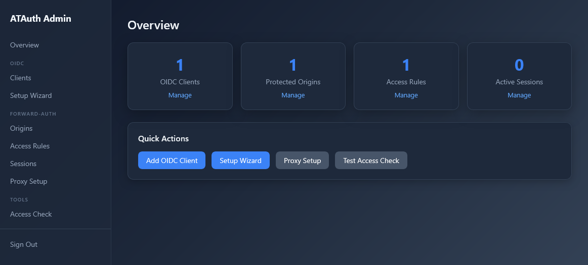
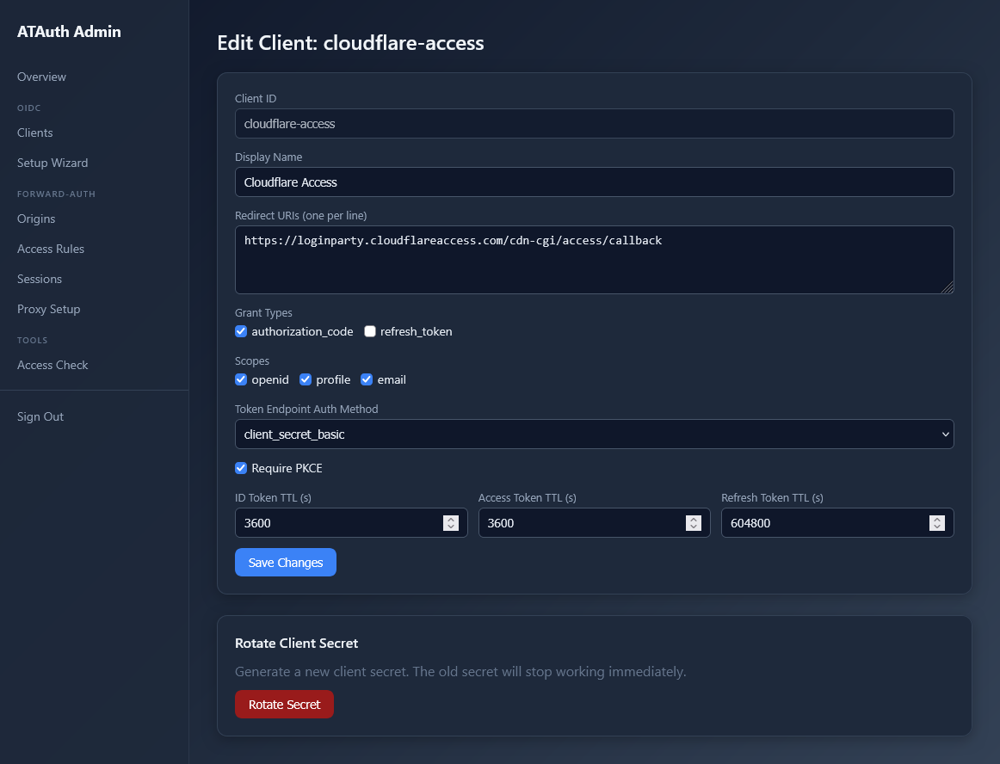
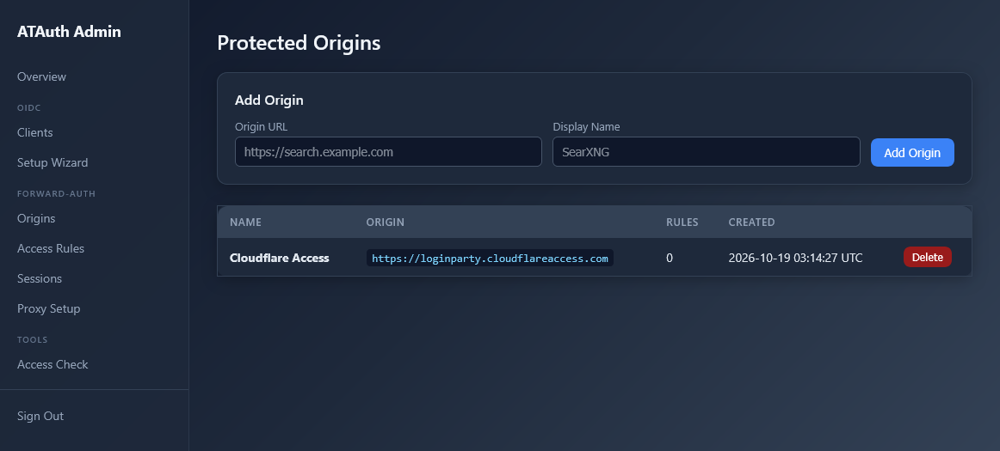
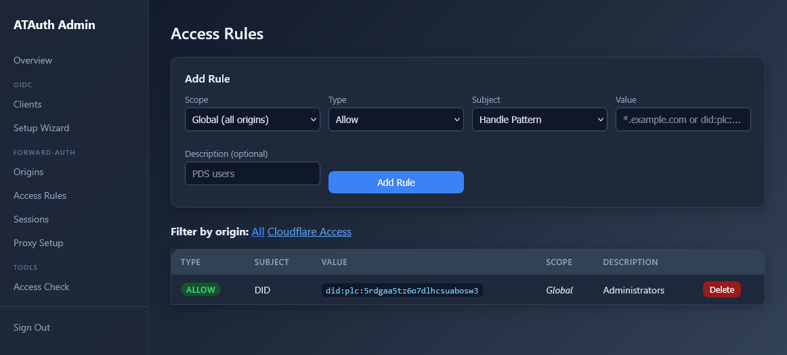
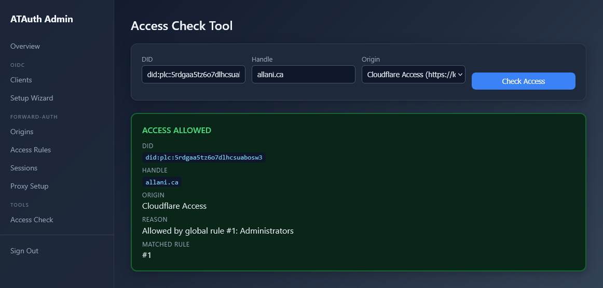
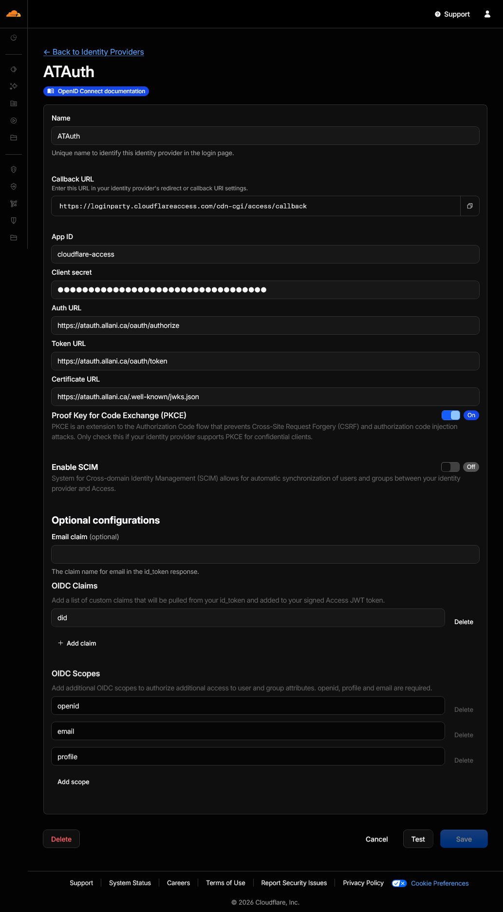
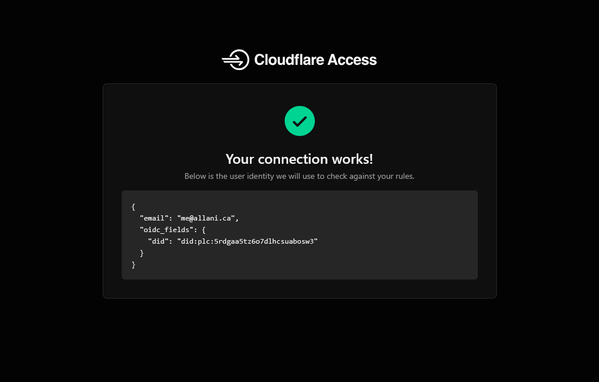

> **Originally based on [Tynan Purdy's ATAuth](https://tangled.org/tynanpurdy.com/atauth),
> itself based on [Cache8063/atauth](https://github.com/Cache8063/atauth).**

# ATAuth - OIDC for AT Protocol

ATAuth is a self-hosted OpenID Connect (OIDC) provider that lets applications use an AT Protocol identity—such as a Bluesky account—for sign-in. A user starts with their `@handle`; ATAuth uses the user's Personal Data Server (PDS) to complete AT Protocol OAuth, then issues standard OIDC tokens to registered applications.

## Why This Exists

AT Protocol OAuth and OpenID Connect solve related problems, but they are different protocols. Many infrastructure tools and self-hosted applications already support OIDC, while they do not natively know how to sign a user in through that user's AT Protocol identity and PDS.

Without a bridge, each application would need its own AT Protocol integration, or users would need to maintain a separate account in another identity system. ATAuth provides that bridge once:

- **Sign in with AT Protocol.** Users authenticate through their own PDS, whether that is Bluesky-hosted or self-hosted.
- **Use standard OIDC with your apps.** ATAuth exposes OIDC discovery, authorization, token, UserInfo, and JWKS endpoints for compatible relying parties.
- **Keep one stable identity across services.** The DID is the durable account identifier; the handle is available for display and username mapping.
- **Self-host the identity layer.** You control the deployment and configure which registered applications and identities can access it.

A practical use case is using a Bluesky identity with Cloudflare Access to protect personal infrastructure and internal tools. The same ATAuth instance can also serve OIDC-compatible applications such as dashboards and self-hosted services. Apps that do not support OIDC can use ATAuth's optional nginx `auth_request` forward-auth integration.

ATAuth is not a PDS and does not replace Bluesky or another AT Protocol service. It bridges AT Protocol authentication to OIDC so existing applications can use it without implementing AT Protocol themselves.

## How It Works

```text
Your app (OIDC client / relying party)
              |
              | OpenID Connect
              v
        ATAuth (OIDC provider)
              |
              | AT Protocol OAuth
              v
      User's PDS / authorization server
              |
              v
      User authenticates with AT Protocol

ATAuth returns OIDC tokens to the registered app.
```

Any application that supports standard OpenID Connect can integrate through its OIDC settings. Applications without OIDC support can use the optional forward-auth integration.

## Features

- **Standard OIDC Provider**: Discovery, authorization, token, UserInfo, revocation, and JWKS endpoints
- **AT Protocol OAuth**: Authenticate through Bluesky or a compatible self-hosted PDS
- **Passkey Login**: WebAuthn/FIDO2 support—users can register passkeys and skip the AT Protocol OAuth flow
- **Forward-Auth SSO Proxy**: nginx `auth_request` based single sign-on for web services without OIDC support
- **Admin Dashboard**: Web UI with a setup wizard for 20+ common self-hosted apps
- **Access Control**: Per-user DID and handle-pattern rules with deny-overrides
- **PKCE Support**: Configurable per client
- **ES256-Signed JWTs**: Signing keys published through the JWKS endpoint

## Screenshots

ATAuth includes a web-based administration interface for managing authentication,
OIDC clients, origins, access rules, and integrations.

### Administration

The main administration interface provides an overview of your ATAuth deployment
and access to its configuration.



### OIDC Clients

Configure the applications that are allowed to use ATAuth for authentication,
including their redirect URIs, scopes, and authentication settings.



### Origins

Manage the origins that are permitted to use ATAuth.



### Access Rules

Create and manage rules controlling which users and applications can access
protected resources.



### Access Checks

Test and inspect access decisions directly from the administration interface.



### Cloudflare Integration

ATAuth can integrate with Cloudflare to provide authentication for protected
applications and services.

The Cloudflare integration guides you through configuring the required identity
providers.



Once configured, ATAuth can verify that the Cloudflare integration is working
correctly.



## Quick Start

### Prerequisites

- Docker and Docker Compose
- A domain with a DNS record pointing to your server (e.g. `auth.yourdomain.com`)
- A reverse proxy that terminates TLS (Cloudflare Tunnel, Caddy, Traefik, or nginx)

### 1. Clone and configure

```bash
git clone https://github.com/allani-ca/atauth.git
cd atauth
cp gateway/.env.example .env
```

Edit `.env` and replace every instance of `auth.yourdomain.com` with your actual domain:

```env
# These must all use your real domain
OAUTH_CLIENT_ID=https://auth.yourdomain.com/client-metadata.json
OAUTH_REDIRECT_URI=https://auth.yourdomain.com/auth/callback
OIDC_ISSUER=https://auth.yourdomain.com
WEBAUTHN_RP_ID=auth.yourdomain.com
WEBAUTHN_ORIGIN=https://auth.yourdomain.com
CORS_ORIGINS=https://app1.yourdomain.com,https://app2.yourdomain.com
```

Generate and fill in the three required secrets (run the command once per value):

```bash
openssl rand -hex 32
```

```env
ADMIN_TOKEN=<paste-generated-value>
OIDC_KEY_SECRET=<paste-generated-value>
MFA_ENCRYPTION_KEY=<paste-generated-value>
```

### 2. Start the service

```bash
docker compose up -d
```

The gateway starts on `127.0.0.1:3100`. Put a reverse proxy with TLS in front of it. For example, [Caddy](https://caddyserver.com/) can provision HTTPS automatically:

```caddyfile
auth.yourdomain.com {
    reverse_proxy localhost:3100
}
```

See the [Homelab Deployment Guide](docs/HOMELAB.md) for Traefik and nginx examples.

### 3. Verify it's running

```bash
curl https://auth.yourdomain.com/.well-known/openid-configuration
```

You should receive a JSON document describing the OIDC endpoints.

### 4. Register your first app

Open `https://auth.yourdomain.com/admin/login`, enter your `ADMIN_TOKEN`, and use the setup wizard to register an app. The wizard includes presets that fill in redirect URIs, scopes, and grant types.

Save the returned **client secret**; it is only shown once.

### 5. Configure your app

Point your application's OIDC settings at ATAuth's discovery URL:

| Setting | Value |
| --- | --- |
| Discovery URL | `https://auth.yourdomain.com/.well-known/openid-configuration` |
| Client ID | The ID you chose in the wizard |
| Client Secret | The secret returned at registration |
| Scopes | `openid profile` (add `email` if needed) |

For a generic OIDC integration, use the endpoints and supported claims advertised by ATAuth's discovery document. Cloudflare Access can be configured as an OIDC identity provider; use the callback URL shown in your Cloudflare Zero Trust configuration when registering the client.

## Supported Apps

The setup wizard includes presets for:

| App | Auth Method |
| --- | --- |
| Cloudflare Identity Provider | OIDC (OpenID Connect) |
| Audiobookshelf | OIDC (OpenID Connect) |
| Jellyfin | OIDC (via SSO plugin) |
| Gitea / Forgejo | OIDC (built-in) |
| Nextcloud | OIDC (via app) |
| Immich | OIDC (built-in) |
| Grafana | OIDC (built-in) |
| Wiki.js | OIDC (built-in) |
| Portainer | OIDC (built-in) |
| Outline | OIDC (built-in) |
| Mealie | OIDC (built-in) |
| Paperless-ngx | OIDC (built-in) |
| Vaultwarden | OIDC (built-in) |
| Miniflux | OIDC (built-in) |
| Mattermost | OIDC (built-in) |
| Vikunja | OIDC (built-in) |
| Plane | OIDC (built-in) |
| GoToSocial | OIDC (built-in) |
| Stirling-PDF | OIDC (built-in) |
| Tandoor Recipes | OIDC (built-in) |
| FreshRSS | OIDC (built-in) |
| Any web service | Forward-auth proxy (nginx `auth_request`) |

Other applications that support standard OIDC can be configured using their generic OIDC settings even if the wizard does not have a preset.

## Forward-Auth Proxy

For applications without OIDC support, ATAuth provides nginx `auth_request`-based SSO. Enable it in `.env`:

```env
FORWARD_AUTH_ENABLED=true
FORWARD_AUTH_SESSION_SECRET=<generate-with-openssl-rand-hex-32>
```

Then configure nginx:

```nginx
location / {
    auth_request /auth/verify;
    auth_request_set $auth_did $upstream_http_x_auth_did;
    auth_request_set $auth_handle $upstream_http_x_auth_handle;
    proxy_set_header X-Auth-DID $auth_did;
    proxy_set_header X-Auth-Handle $auth_handle;
    proxy_pass http://your-app;
}

location = /auth/verify {
    internal;
    proxy_pass http://atauth:3100;
    proxy_pass_request_body off;
    proxy_set_header Content-Length "";
    proxy_set_header X-Original-URL $scheme://$http_host$request_uri;
}
```

The admin dashboard generates these configuration snippets for you.

## Self-Hosted PDS

ATAuth can authenticate users through a self-hosted PDS as well as Bluesky-hosted infrastructure. For example, users might have handles such as `@alice.your-domain.com`. ATAuth discovers the user's PDS from their handle; no special configuration is normally needed.

The exact availability of login and email claims depends on the capabilities and permissions of the user's PDS.

## Architecture

| Component | Description |
| --- | --- |
| Gateway | Node.js/Express 5, TypeScript, SQLite |
| Identity | AT Protocol OAuth through the user's PDS |
| OIDC tokens | Signed JWTs; signing keys published through JWKS |
| Proxy cookies | HMAC-SHA256 signed, typed |
| Access control | Deny-overrides, per-origin and global rules |

## Security

- No hardcoded secrets; sensitive configuration is validated at startup
- Client secrets stored as SHA-256 hashes
- One-time flash tokens for secret display (never in URLs)
- PKCE support, configurable per client
- Constant-time comparison for secret verification
- HTML escaping on server-rendered pages
- HMAC-signed CSRF tokens on dashboard forms
- Rate limiting on authentication endpoints
- Content Security Policy with per-request nonces for inline scripts
- Designed to work behind a reverse proxy and compatible with common WAF configurations

## Documentation

- [Homelab Deployment Guide](docs/HOMELAB.md)
- [Security Policy](SECURITY.md)
- [Changelog](CHANGELOG.md)

## Credits & Sources

ATAuth builds on work from the AT Protocol community.

The project was originally based on [Tynan Purdy's ATAuth repository on Tangled](https://tangled.org/tynanpurdy.com/atauth), which provided the foundation for this implementation.

The original upstream project is [Cache8063/atauth on GitHub](https://github.com/Cache8063/atauth). The upstream project provides an AT Protocol authentication library and gateway for applications using Bluesky and self-hosted PDS infrastructure.

This repository has since developed independently, with additional features, fixes, integrations, and changes made for its own use cases and deployment model.

### Upstream

- [Tynan Purdy / ATAuth on Tangled](https://tangled.org/tynanpurdy.com/atauth)
- [Cache8063/atauth on GitHub](https://github.com/Cache8063/atauth)

## License

MIT
